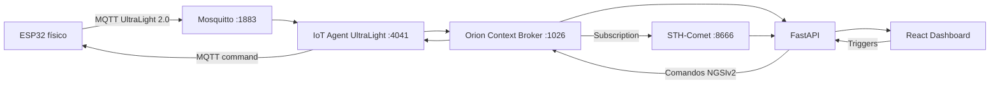

# VinTrace — Monitoramento Inteligente de Adegas

> Projeto acadêmico CP5 · FIAP — Engenharia de Software · Edge Computing & FIWARE · 2026

O **VinTrace** monitora temperatura, umidade e luminosidade de uma adega com ESP32 e sensores físicos, armazena histórico no FIWARE/STH-Comet, permite configurar triggers pelo dashboard e aciona alertas remotos no dispositivo quando alguma variável sai da faixa definida.

O projeto também inclui o **Wine Memory**, um Passaporte Ambiental que transforma o histórico real em incidentes de exposição para facilitar a leitura das condições de armazenamento.

## Links

- Dashboard: https://vintrace-wheat.vercel.app
- Backend: https://vintrace-backend.onrender.com
- Wokwi: https://wokwi.com/projects/478447086402895873
- Repositório: https://github.com/br330a/vintrace

## 1. Arquitetura



### Fluxo de telemetria

```text
DHT11 + LDR
    ↓
ESP32
    ↓ MQTT UltraLight
Mosquitto
    ↓
IoT Agent UltraLight
    ↓ NGSIv2
Orion Context Broker
    ↓ Subscription
STH-Comet
    ↓
FastAPI
    ↓
Dashboard React
```

### Fluxo dos alertas

```text
Dashboard
    ↓ alteração dos triggers
FastAPI
    ↓ monitoramento do valor atual
Orion
    ↓ comando alertTemp / alertHum / alertLum
IoT Agent
    ↓ MQTT
ESP32
    ↓
LED azul + buzzer + TFT
```

O alerta é comandado remotamente pela aplicação. A comparação dos valores com os limites não fica restrita ao firmware.

## 2. Contrato FIWARE

| Item | Valor |
|---|---|
| Entity type | `VinTrace` |
| Device ID principal | `vintrace001` |
| Entity URN | `urn:ngsi-ld:VinTrace:001` |
| FIWARE Service | `smart` |
| FIWARE Service Path | `/` |
| API Key | `TEF` |
| Temperatura | `t` → `temperature` |
| Umidade | `h` → `humidity` |
| Luminosidade | `l` → `luminosity` |
| Comando de temperatura | `alertTemp` |
| Comando de umidade | `alertHum` |
| Comando de luminosidade | `alertLum` |
| Valores dos comandos | `high`, `low`, `off` |

### Tópicos MQTT

```text
Telemetria:       /ul/TEF/vintrace001/attrs
Comandos:         /TEF/vintrace001/cmd
Resultado comando:/ul/TEF/vintrace001/cmdexe
```

Exemplo de telemetria:

```text
t|25.8|h|53|l|52
```

## 3. Hardware físico

| Componente | Pino ESP32 |
|---|---:|
| DHT11 DATA | GPIO 4 |
| LDR | GPIO 34 |
| TFT SCK | GPIO 18 |
| TFT MOSI | GPIO 23 |
| TFT CS | GPIO 21 |
| TFT DC | GPIO 16 |
| TFT RST | GPIO 17 |
| LED azul | GPIO 27 |
| Buzzer passivo | GPIO 25 |

O display utilizado é um **TFT ST7735 1,8" 128×160**, configurado em modo paisagem.

O firmware apresenta:

- valores atuais de temperatura, umidade e luminosidade;
- status normal;
- alerta de temperatura alta ou baixa;
- alerta de umidade alta ou baixa;
- alerta de luminosidade alta ou baixa;
- indicação de múltiplas anomalias simultâneas;
- ícones e cores diferentes para cada condição;
- LED azul piscando enquanto houver qualquer alerta;
- buzzer com frequências distintas: 700 Hz, 1100 Hz e 1600 Hz.

## 4. Backend FastAPI

Requer Python 3.11+.

```bash
cd backend
python -m venv .venv
source .venv/Scripts/activate   # Git Bash no Windows
pip install -r requirements.txt
cp .env.example .env
uvicorn app.main:app --reload --port 8000
```

Endpoints principais:

```text
GET    /health
GET    /health/fiware
GET    /devices
POST   /devices
DELETE /devices/{device_id}
GET    /devices/{device_id}/current
GET    /devices/{device_id}/history?period=24h|7d|30d
GET    /devices/{device_id}/triggers
PUT    /devices/{device_id}/triggers
GET    /devices/{device_id}/alerts
GET    /devices/{device_id}/wine-memory
POST   /devices/{device_id}/monitoring/start
POST   /devices/{device_id}/monitoring/stop
POST   /commands
```

Em produção, os triggers são persistidos como atributos da entidade no **Orion**, evitando depender do filesystem efêmero do Render.

## 5. Dashboard React

```bash
cd dashboard/frontend
npm install
npm run dev
```

Validação:

```bash
npm run lint
npm run build
```

O dashboard usa a API real para:

- listar e gerenciar dispositivos IoT;
- exibir leituras atuais;
- mostrar gráficos históricos vindos do STH-Comet;
- configurar triggers das três variáveis;
- consultar alertas;
- exibir o Wine Memory.

## 6. Histórico STH-Comet

O histórico é consultado pela API do STH-Comet na porta `8666`.

Períodos disponíveis no dashboard:

- 24 horas;
- 7 dias;
- 30 dias.

O backend usa agregação temporal quando disponível e paginação do histórico bruto como fallback, em vez de limitar todos os períodos aos últimos 100 registros.

## 7. Wine Memory

O Wine Memory usa o histórico real do STH-Comet para identificar períodos fora dos limites atuais.

Cada incidente informa, quando aplicável:

- sensor;
- direção `high` ou `low`;
- horário inicial;
- horário final ou estado em andamento;
- duração;
- valor de pico;
- descrição da exposição.

**Observação:** o cálculo atual interpreta o histórico com base nos triggers configurados no momento da consulta. Ele não mantém uma versão histórica dos triggers antigos.

## 8. Wokwi

Simulação pública:

https://wokwi.com/projects/478447086402895873

A simulação usa:

- ESP32;
- DHT22;
- LDR;
- LED azul;
- buzzer passivo.

Foram validados alertas de temperatura, umidade e luminosidade com sons distintos.

## 9. Testes já executados

- Backend: `9 passed` no `pytest`.
- Frontend: `npm run lint` aprovado.
- Frontend: `npm run build` aprovado.
- Orion, IoT Agent e STH-Comet respondendo nos health checks.
- Telemetria física chegando ao Orion e ao STH-Comet.
- ESP32 físico online e reconectando após reinício.
- Cadastro e exclusão de IoT Device pelo backend.
- Triggers persistidos no Orion e mantidos após restart do backend.
- Alertas `high`, `low` e `off` testados no ESP32.
- Múltiplos alertas simultâneos testados no TFT.
- Normalização remota testada.
- Histórico 24h, 7d e 30d vindo do STH-Comet.
- Wine Memory validado com incidente `direction: high`.
- Wokwi público validado com DHT22 + LDR.

A matriz detalhada está em [`docs/plano-de-testes.md`](docs/plano-de-testes.md).

## 10. Segurança

Não versionar:

```text
firmware/secrets.h
backend/.env
senhas de Wi-Fi
tokens
credenciais privadas
```

O repositório inclui apenas arquivos de exemplo, como `secrets.example.h` e `.env.example`.

## 11. Documentação

- Arquitetura: [`docs/arquitetura.md`](docs/arquitetura.md)
- Manual de software: [`docs/manual-software.md`](docs/manual-software.md)
- Manual de hardware: [`docs/manual-hardware.md`](docs/manual-hardware.md)
- Plano de testes: [`docs/plano-de-testes.md`](docs/plano-de-testes.md)
- Evidências: [`docs/evidencias/README.md`](docs/evidencias/README.md)
- Equipe: [`docs/equipe.md`](docs/equipe.md)
- Infraestrutura FIWARE: [`infrastructure/fiware/README.md`](infrastructure/fiware/README.md)
- Firmware: [`firmware/README.md`](firmware/README.md)
- Wokwi: [`wokwi/README.md`](wokwi/README.md)

## 12. Operação no dia da apresentação

1. Iniciar o Lab da AWS/Vocareum.
2. Confirmar Orion, IoT Agent e STH-Comet.
3. Aguardar o backend do Render estar ativo.
4. Alimentar o ESP32.
5. Aguardar Wi-Fi e MQTT conectarem.
6. Abrir https://vintrace-wheat.vercel.app.
7. Confirmar que `vintrace001` aparece online.
8. Demonstrar leitura, histórico, triggers, alerta físico, normalização e Wine Memory.

O Arduino IDE não é necessário durante a demonstração normal.

## 13. Equipe

- Felipe Ilek
- Bruno Gonçalves Minitti
- Marcos Vinícius Tudisco
- Michel Tatsuya Hanada
- Nicolas Gomes de Almeida
- Lucas Ferreira Rodrigues Silva

Os RMs estão em [`docs/equipe.md`](docs/equipe.md).
